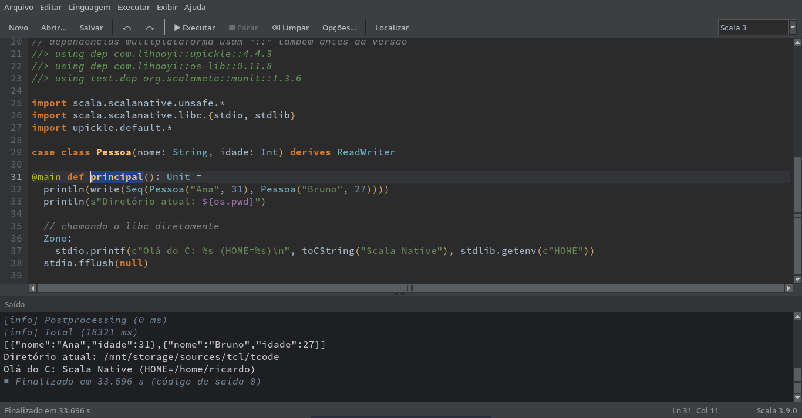

# tcode

Editor/console para avaliação rápida de código em várias linguagens, escrito em
Tcl/Tk. Não é uma IDE: é **um arquivo só** (`tcode.tcl`), sem dependências além
de Tcl/Tk 8.6 ou 9.x.

Inspirado no *groovyConsole*: editor em cima, saída da execução embaixo. O
código roda em um processo separado, então a interface não trava e a execução
pode ser interrompida a qualquer momento.



> Internamente o programa se identifica como **qconsole** (versão 2.0): esse é
> o nome usado no arquivo de configuração e no diretório de linguagens do
> usuário.

## Recursos

- Destaque de sintaxe, números de linha, realce da linha atual e de pares de
  parênteses/chaves/colchetes
- Guias de coluna: linhas verticais nas colunas 80 e 120 (Exibir > Guias de
  coluna liga/desliga; Exibir > Colunas das guias… muda as colunas) e guias de
  indentação, uma por nível (Exibir > Guias de indentação)
- Parênteses coloridos por nível de aninhamento ("rainbow") em Scheme, Tcl e
  OCaml; os que ficam sem par (ou com o par trocado, ex.: `(]`) em vermelho
- Em Scheme, `define` e `lambda` aparecem como `λ` (só na tela: o arquivo não muda; a
  palavra sob o cursor volta a aparecer para edição). Exibir > Símbolos no
  lugar de palavras liga/desliga
- Abas: cada arquivo aberto tem a sua (com desfazer, cursor e linguagem
  próprios); ● marca alterações não salvas, o botão do meio fecha, o botão
  direito tem Fechar / Fechar as outras / Copiar caminho. As abas são
  reabertas na próxima vez
- Ir para definição (F12 ou Ctrl+clique, Alt+← volta): com Ctrl
  pressionado, os nomes que têm definição ficam sublinhados. Procura nas abas abertas e nos
  arquivos da pasta aberta; com mais de uma definição, mostra um menu para
  escolher. Ao parar o mouse sobre um nome, uma dica mostra a linha da
  definição e os comentários logo acima dela (Exibir > Mostrar definição ao
  passar o mouse). As definições vêm das palavras `defWords` da linguagem
  (`proc`, `let rec`, `def`, `define`…) e das regexes `defPatterns`. Em Tcl e
  Scheme, nomes que não são do projeto são procurados nas bibliotecas
  instaladas (indexadas em segundo plano): os `proc`s do Tcl/Tk/tcllib (pelo
  nome completo, ex.: `tk::TextKeySelect`) com os comentários acima deles, e
  no Guile os procedimentos embutidos (`guile-procedures.txt`, com
  assinatura e documentação) e os `define` dos módulos, com a docstring
- Recolher/expandir blocos: com o mouse sobre a margem, uma seta aparece
  ao lado das linhas que abrem um bloco; o clique recolhe (a linha fica
  com `⋯`, que expande de novo ao ser clicado). Os blocos vêm da indentação
  (em Markdown, também dos títulos). Ctrl+Shift+[ / Ctrl+Shift+] recolhem o
  bloco do cursor e expandem o da linha; Exibir > Recolher tudo / Expandir
  tudo. Levar o cursor para dentro de um bloco recolhido (Ir para linha,
  Localizar, F12…) o expande
- Home vai ao primeiro caractere não branco da linha (de novo: coluna 0);
  Shift+Home seleciona até lá
- Indentação automática por linguagem, Tab/Shift+Tab em blocos, comentar e
  descomentar linhas, duplicar linha
- Fechamento automático de parênteses, colchetes, chaves e aspas; com texto
  selecionado, o par envolve a seleção
- Vários cursores no estilo Sublime: Ctrl+D seleciona a próxima ocorrência da
  seleção, Alt+F3 todas, Alt+clique, Ctrl+clique (fora de um nome com definição) ou
  Shift+Alt+↑/↓ adicionam cursores; o
  que for digitado vale para todos
- Autocompletar (Ctrl+Espaço, ou sozinho ao digitar 3 letras): sugere palavras
  do arquivo aberto, palavras-chave da linguagem e, com uma pasta aberta,
  palavras dos arquivos da pasta da mesma linguagem (indexados em segundo
  plano). ↑/↓ escolhem, Enter/Tab aceitam, Esc fecha; Editar > Sugerir ao
  digitar liga/desliga o modo automático
- Painel lateral com a árvore de arquivos de uma pasta (Arquivo > Abrir pasta,
  Ctrl+Shift+O; Ctrl+B mostra/esconde; `tcode pasta/` abre direto)
- Terminal embutido (Exibir > Terminal, Ctrl+'): um xterm com as cores do
  editor, aberto na pasta do projeto, ao lado da saída ou no lugar dela
  (Exibir > Terminal ao lado / no lugar da saída). No modo "no lugar", a
  saída volta à frente ao executar. O teclado vai para o terminal enquanto o
  mouse estiver sobre ele; `exit` fecha o painel e ⟳ reinicia o shell.
  Exibir > Comando do terminal… troca o emulador (`%W` = id da janela onde
  ele é embutido, `%D` = pasta; ex.: `urxvt -embed %W -cd %D`, `st -w %W`).
  Requer X11 (no Wayland funciona via XWayland)
- Comandos de projeto: um arquivo `.qconsole` na raiz do projeto define o que
  o Ctrl+Alt+R executa (ex.: `sbt run`); Ctrl+R continua executando o arquivo
  e Ctrl+Shift+R a seleção (veja abaixo)
- Localizar/substituir (com regex e diferenciação de maiúsculas), ir para linha
- Executar o arquivo inteiro ou só a seleção, com opções do interpretador e
  argumentos do programa configuráveis por linguagem
- Mensagens de erro clicáveis na saída: levam direto à linha (e coluna) do
  erro no editor
- Formatar código (Editar > Formatar código, Ctrl+Shift+F) e verificar código
  com um linter (Editar > Verificar código, F8), em segundo plano. Os
  problemas aparecem na saída com links e as linhas ficam marcadas no editor
  (erros em vermelho, avisos em amarelo). A formatação mexe só nas linhas que
  mudam e é desfeita com um Ctrl+Z (veja a tabela abaixo)
- Saída com cores ANSI, stderr, avisos e mensagens informativas destacados
- Markdown: destaque no editor e pré-visualização ao lado (Exibir >
  Pré-visualização do Markdown, Ctrl+Shift+M, ou Ctrl+R), atualizada ao
  digitar e acompanhando a rolagem do editor; duplo clique na
  pré-visualização leva à linha no editor. Arquivo > Exportar para HTML…
  (Ctrl+Shift+E) gera uma página completa (tema claro/escuro, código
  colorido com as cores do editor); Arquivo > Abrir no navegador mostra
  uma cópia temporária no navegador (veja abaixo)
- Detecção automática do interpretador e da versão instalada
- Modelos de código (Arquivo > Novo a partir de modelo)
- Arquivos recentes, tamanho de fonte, quebra de linha, geometria da janela e
  linguagem são lembrados entre sessões
- Tema escuro inspirado no Darcula
- Novas linguagens podem ser adicionadas por arquivos externos, sem mexer no
  script

## Linguagens embutidas

| Linguagem | Extensões | Interpretadores |
|-----------|-----------|-----------------|
| Tcl/Tk    | `.tcl .tk .tm .test` | `tclsh` (de preferência o da mesma instalação do `wish`) |
| Scala 3   | `.sc .scala` | `scala`, `scala-cli` |
| Groovy    | `.groovy .gvy .gy .gsh .gradle` | `groovy` (PATH, `GROOVY_HOME` ou SDKMAN) |
| Scheme (Chez), (Guile), (Kawa) | `.scm .ss .sls .sps .sld` | `scheme`/`petite`, `guile`, `kawa` |
| OCaml     | `.ml .mli .mlx` | `ocaml`, OxCaml (switch do opam) |
| Shell     | `.sh .bash .zsh .ksh` | `bash`, `sh`, `zsh`, `dash` |
| Markdown  | `.md .markdown .mkd .mdown` | — (Ctrl+R pré-visualiza) |

Detalhes por linguagem:

- **Tcl** — o script roda num wrapper que mostra o valor de retorno do script
  ("Resultado: …") e o `errorInfo` em caso de erro. Se o script criar janelas
  Tk, elas permanecem abertas até serem fechadas.
- **Scala 3** — detecta se o código é um script (`.sc`, instruções soltas) ou
  um fonte com `@main`/`def main`/`extends App` (`.scala`). Há modelos para
  JVM, Scala.js e Scala Native usando diretivas `//> using` do scala-cli.
- **Groovy** — destaque de GStrings (`${...}` e `$nome`), strings
  `"""`/`'''`, slashy (`~/re/`) e dollar-slashy (`$/.../$`), anotações e
  nomes de métodos declarados com tipo (`String nome(`), que também entram no
  F12. Cobre a sintaxe até o Groovy 6: `val`, `record`, `sealed`/`non-sealed`/
  `permits`, `switch` com `->`/`yield`, `async`/`await`. As palavras-chave
  contextuais só são destacadas em posição de palavra-chave (`def val = 5` e
  `record.a` continuam nomes comuns); em `val String s`, `s` é o nome definido.
  Na desestruturação (`def (a, b) = lista`, `val (int x, String s) = rec`,
  `def (x: a, y: b) = rec`, `def (h, *resto) = lista`) cada nome recebe a cor
  de definição e entra no F12. Na saída, a pilha de exceções aparece uma vez só (sem o registro
  duplicado do Groovy 6) e os quadros internos do Groovy/Java ficam em cinza.
  Fora do `PATH`, o `groovy` é procurado em `GROOVY_HOME` e no SDKMAN. Há
  modelos de script, de script com `@Grab` (dependências do Maven Central) e
  de classe com `main`. Se um `@Grab` não resolver, a saída aponta (com link)
  para a linha dele, e o relatório do Ivy fica em cinza.
- **Scheme** — Chez, Guile e Kawa aparecem separados no combo e no menu
  Linguagem: cada um tem o seu interpretador, o seu verificador e as suas
  palavras destacadas. A indentação no estilo Lisp e o formatador são os
  mesmos. Como os três usam `.scm`, ao abrir um arquivo a implementação vem de:
  1. cabeçalho do Emacs/Geiser na 1ª linha (ou na 2ª, depois de um shebang):
     `;; -*- mode: scheme; geiser-scheme: kawa -*-` (`chez`, `guile` ou
     `kawa`), ou o mesmo `geiser-scheme:` num bloco `Local Variables:` no fim;
  2. shebang: `#!/usr/bin/env guile`, `#!/usr/bin/env -S kawa`,
     `#!/usr/bin/scheme --script`;
  3. pistas no código: `(use-modules …)`/`(ice-9 …)` → Guile,
     `(chezscheme)` → Chez, `(kawa …)`, `define-simple-class`, `module-name` → Kawa;
  4. sem nada disso, a primeira instalada na ordem Chez, Guile, Kawa.

  Linguagem > Indicar implementação de Scheme no arquivo grava (ou atualiza) o
  cabeçalho com a implementação escolhida no combo. O vim não tem convenção
  para a implementação (só `ft=scheme`), por isso o padrão usado é o do Geiser.
  No Guile o código é compilado antes de rodar, para que os erros tragam linha
  e coluna. No Kawa são destacadas as formas próprias (`define-simple-class`,
  `define-alias`, `try-catch`, `#!optional`…), as continuações delimitadas de
  `(kawa continuations)` (`reset`, `shift`, `async`/`await`,
  `make-coroutine-generator`, `with-effect-handler`/`perform`…), o FFI de
  `(kawa foreign)` (`define-foreign-procedure`, `define-foreign-struct`,
  `foreign-ref`, `foreign-null`…) e a depuração (`trace`, `untrace`, `time`,
  `disassemble`). A pilha de exceções Java aponta para a linha do script, e os
  quadros internos (`gnu.`, `kawa.`, `java.`) e o relatório do `time` ficam em cinza.
- **Markdown** — o leitor embutido cobre o CommonMark usual e as extensões
  do GitHub mais comuns: títulos (`#` e sublinhados), ênfase, `código`,
  ~~riscado~~, listas (aninhadas, numeradas, de tarefas `- [ ]`), citações,
  blocos de código (```` ``` ```` com linguagem: as do tcode saem coloridas),
  tabelas com alinhamento, links (inclusive `[texto][ref]`, `<url>` e URLs
  soltas), imagens e HTML embutido (passado como está para o HTML
  exportado). Na pré-visualização, imagens locais PNG/GIF/SVG aparecem
  (reduzidas se forem largas); links externos abrem no navegador, links
  para arquivos abrem no editor e `#âncora` rola até o título. Enter
  continua listas e citações (num item vazio, encerra a lista).
- **OCaml** — o runner OxCaml procura o toplevel no switch ativo do opam
  (`OPAM_SWITCH_PREFIX`) ou em `~/.opam/*ox*/bin/ocaml`.

### Formatação e linter

| Linguagem | Formatar (Ctrl+Shift+F) | Verificar (F8) |
|-----------|-------------------------|----------------|
| Tcl       | [`tclfmt`](https://github.com/nmoroze/tclint) | [`tclint`](https://github.com/nmoroze/tclint) |
| Scala 3   | `scala fmt` (scalafmt, baixado pelo Scala CLI) | `scala compile` com `-Wunused:imports,privates,locals -deprecation -feature` |
| Groovy    | `npm-groovy-lint --format` | `groovyc` (compila sem executar); sem ele, `npm-groovy-lint` |
| Scheme (Guile) | embutido: reindentação no estilo do Emacs | `guild compile` com avisos de variável não usada/não definida, nº de argumentos, `format`… |
| Scheme (Chez)  | embutido: reindentação no estilo do Emacs | compilação sem executar: sintaxe, nº de argumentos e identificadores não definidos |
| Scheme (Kawa)  | embutido: reindentação no estilo do Emacs | `kawa -C` (compila sem executar) com avisos de variável não definida, código inalcançável, `void` usado… |
| OCaml / OxCaml | `ocamlformat` (ou `ocp-indent`, se não houver) | `ocamlc -c` com os avisos `:standard` do dune |

- O verificador de Scheme segue o interpretador escolhido (cada implementação tem o seu).
- Editar > Formatar ao salvar (por linguagem, desligado por padrão) formata
  o arquivo a cada salvamento. O formatador embutido do Scheme roda antes de
  gravar; as ferramentas externas rodam em segundo plano depois do Ctrl+S e
  o arquivo é salvo de novo se algo mudar. Se a ferramenta der erro, o
  arquivo fica salvo como estava.
- `tclint.toml`/`.tclint`, `.scalafmt.conf`, `.ocamlformat` e
  `.groovylintrc.json` são procurados
  da pasta do arquivo para cima e passados à ferramenta. Sem `.ocamlformat`,
  o `ocamlformat` usa o perfil padrão.
- Em OCaml, as ferramentas são procuradas primeiro na pasta do interpretador
  escolhido (o switch do opam, no caso do OxCaml) e depois no `PATH`. O
  `ocamlc -c` recebe `-I <pasta do arquivo>` e, das opções do interpretador,
  só `-I`, `-w`, `-alert`, `-open`, `-ppx`, `-rectypes`, `-extension`… (não os
  `.cma`).
- As opções do interpretador (Ctrl+E) valem também para `scala compile` e
  para o Chez; no `guild`, só `-L`, `-x`, `--r6rs` e `--r7rs`; no `kawa -C`,
  só `--r7rs`, `--scheme` e `--[no-]full-tailcalls`.
- `tclint`/`tclfmt`: `pip install tclint`. Para usar outro executável, defina
  `exe.<nome>.<linguagem>` em `~/.qconsolerc` (ex.: `exe.tclint.tcl`).

## Uso

```sh
wish tcode.tcl ?-lang tcl|scala|scheme|scheme-chez|scheme-guile|scheme-kawa|ocaml|shell? ?arquivo?
```

Ou, com permissão de execução:

```sh
./tcode.tcl exemplo.scm
```

Sem `-lang`, a linguagem é escolhida pela extensão do arquivo; sem arquivo, é
usada a última linguagem da sessão anterior.

Se o interpretador não for encontrado no `PATH`, indique o executável em
**Executar > Opções de execução** (Ctrl+E). Na mesma janela é possível escolher
o interpretador, as opções passadas a ele e os argumentos do programa.

## Atalhos de teclado

| Atalho | Ação |
|--------|------|
| Ctrl+R / Ctrl+Enter | Executar o arquivo |
| Ctrl+Shift+R | Executar seleção |
| Ctrl+Alt+R | Executar o comando do projeto (`.qconsole`) |
| Ctrl+Shift+O | Abrir pasta |
| Ctrl+B | Mostrar/esconder o painel de arquivos |
| Ctrl+Shift+M | Mostrar/esconder a pré-visualização do Markdown |
| Ctrl+Shift+E | Exportar Markdown para HTML |
| Ctrl+' / Ctrl+` | Mostrar/esconder o terminal |
| Ctrl+Break | Interromper execução |
| Ctrl+W | Limpar saída |
| Ctrl+E | Opções de execução |
| Ctrl+N / Ctrl+O / Ctrl+S | Novo / Abrir / Salvar |
| Ctrl+Shift+S | Salvar como |
| Ctrl+F4 | Fechar aba |
| Ctrl+Tab / Ctrl+PgDn | Próxima aba |
| Ctrl+Shift+Tab / Ctrl+PgUp | Aba anterior |
| Ctrl+Q | Sair |
| Ctrl+Z / Ctrl+Y | Desfazer / Refazer |
| Ctrl+F / Ctrl+H | Localizar / Substituir |
| F3 / Shift+F3 | Próximo / Anterior |
| Ctrl+L | Ir para linha |
| F12 / Alt+← | Ir para definição / Voltar |
| Ctrl+D | Selecionar palavra / próxima ocorrência (vários cursores) |
| Alt+F3 | Selecionar todas as ocorrências |
| Ctrl+clique | Ir para definição (com Ctrl, o nome que tem definição fica sublinhado); fora de um nome assim, adicionar cursor |
| Alt+clique | Adicionar cursor |
| Shift+Alt+↑ / Shift+Alt+↓ | Adicionar cursor na linha acima / abaixo |
| Esc | Voltar a um cursor só |
| Ctrl+Shift+D | Duplicar linha |
| Ctrl+Shift+↑ / ↓ | Mover linha (ou seleção) para cima / baixo |
| Ctrl+Shift+[ / Ctrl+Shift+] | Recolher o bloco do cursor / expandir o da linha |
| Ctrl+/ | Comentar/descomentar linhas |
| Ctrl+Shift+F | Formatar código |
| F8 | Verificar código (linter) |
| Ctrl+Espaço | Completar palavra |
| Tab / Shift+Tab | Indentar / Desindentar |
| Ctrl++ / Ctrl+- / Ctrl+0 | Aumentar / diminuir / restaurar fonte |

## Comandos de projeto (`.qconsole`)

Um arquivo `.qconsole` na raiz do projeto lista comandos, um por linha, no
formato `nome {comando}`. Linhas começando com `#` são comentários:

```tcl
# projeto sbt
run   {sbt run}
test  {sbt test}
build {sbt compile}
```

- **Ctrl+Alt+R** executa o primeiro comando (sem `.qconsole`, executa o
  arquivo). Os outros ficam em Executar > Comandos do projeto.
- **Ctrl+R** continua executando o arquivo atual e **Ctrl+Shift+R** a
  seleção.
- O arquivo é procurado subindo a partir da pasta do arquivo aberto (e da
  pasta aberta no painel lateral).
- Os comandos rodam com `sh -c` na pasta do `.qconsole`. `%F` vira o arquivo
  aberto no editor e `%R` a raiz do projeto.
- O arquivo aberto é salvo antes de executar. Referências `arquivo:linha:coluna`
  na saída (erros do sbt/scalac, por exemplo) viram links.
- Executar > Editar comandos do projeto abre o `.qconsole`, ou cria um modelo
  (com comandos sbt se houver `build.sbt`, make se houver `Makefile`).

## Configuração

As preferências ficam em `~/.qconsolerc` (um dicionário Tcl, gravado ao sair).
Opções de execução são guardadas por linguagem.

## Adicionando linguagens

Arquivos `*.tcl` nestes diretórios são carregados na inicialização:

- `<diretório do tcode.tcl>/lang/`
- `~/.config/qconsole/lang/`

Um arquivo pode definir uma linguagem nova ou redefinir uma embutida. Exemplo
para Lua:

```tcl
qc::language lua {
    name     Lua
    ext      {.lua}
    comment  --                  ;# prefixo de comentário (Ctrl+/)
    indent   2
    tokens {                     ;# ordem = prioridade em empates
        comment {--[^\n]*}       ;# regex ARE, sem grupos de captura...
        string  {"(?:[^"\\\n]|\\.)*"?}
        number  {\m[0-9]+(?:\.[0-9]+)?\M}
        word    {[A-Za-z_][A-Za-z0-9_]*}   ;# "word": classificado por "words"
        brace   {[][(){}]}
    }                            ;# ...ou com UM grupo: só ele é colorido
    words    { keyword {local function end if then else return} }
    defWords {function}          ;# a palavra seguinte recebe a tag defname
    indentAfter {(?:\mthen|\mdo|\mfunction\M.*\)|\{)\s*$}
    runners {
        {name lua exe {lua5.4 lua} args {%O %F %A} version {-v}
         versionRe {Lua ([0-9.]+)}}
    }
    errPatterns {{%F:([0-9]+):}} ;# grupo 1 = linha, grupo 2 = coluna
}
```

Nos `args` do runner:

| Marcador | Significado |
|----------|-------------|
| `%F` | arquivo a executar |
| `%W` | wrapper (chave `wrapper` do runner) |
| `%O` | opções do interpretador definidas pelo usuário |
| `%A` | argumentos do programa |
| `%--A` | `-- args`, se houver argumentos |

Outras chaves aceitas: `capType`, `numberWord`, `sub`, `styles`, `commentRe`,
`commentEnd`, `dedentChars`, `autoPairs`, `defThroughBrace`, `col0`, `infoRe`, `warnRe`,
`grayInfo`, `rainbow` (1 = parênteses coloridos por nível), `pretty` (palavra →
símbolo exibido no lugar dela, ex.: `{define λ}`) (veja `langDefaults` no código).

Hooks opcionais podem ser definidos como procs em `::qc::lang::<id>::` —
`init`, `wordTag`, `prepare`, `defaultExt`, `newlineIndent`, `stderrLine`,
`findExe`, `reformat` (formatador embutido: texto → texto), `run` (substitui
a execução, como no Markdown) (as linguagens embutidas servem de exemplo).

Formatadores e linters externos ficam nas chaves `formatters` e `linters`, com
o mesmo formato dos runners (a descrição completa das chaves está no código,
na seção "Verificação (linter) e formatação"):

```tcl
    linters {
        {name luacheck exe {luacheck} args {--formatter plain %F}
         errPatterns {{%F:([0-9]+):([0-9]+):}} tag warn}
    }
    formatters {
        {name stylua exe {stylua} args {%F} output inplace}
    }
```

Modelos de código são registrados com `qc::template`:

```tcl
qc::template lua "Olá" {print("olá, mundo")}
```

Tags de cor disponíveis: `keyword`, `defname`, `type`, `string`, `comment`,
`number`, `var`, `interp`, `option`, `annot`, `brace`, `directive`, `builtin`,
`constant`, `symbol`. A chave `styles` permite definir novas.

Erros ao carregar arquivos de linguagem aparecem na saída ao iniciar e em
**Ajuda > Sobre**.

## Requisitos

- Tcl/Tk 8.6 ou 9.x
- Os interpretadores das linguagens que você quiser executar
